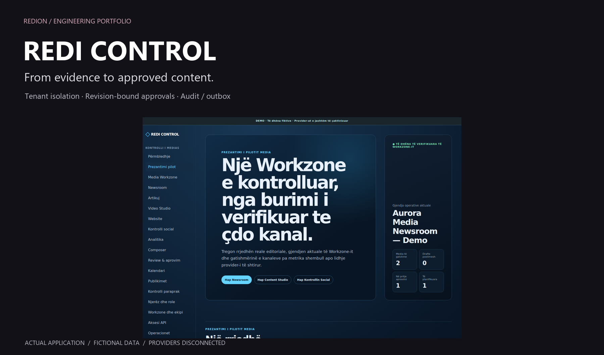
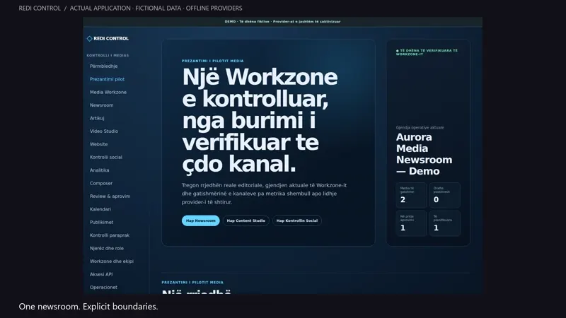
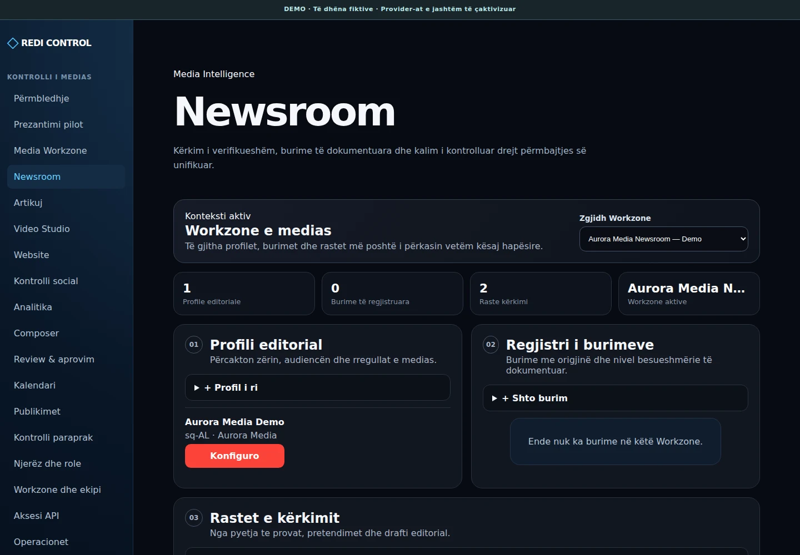
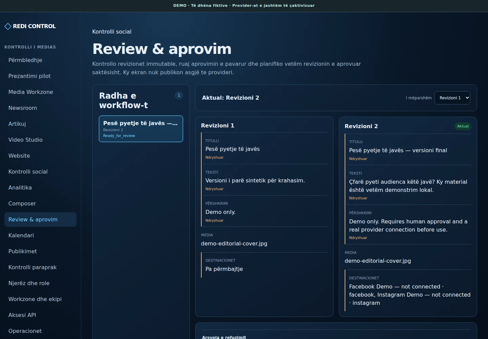
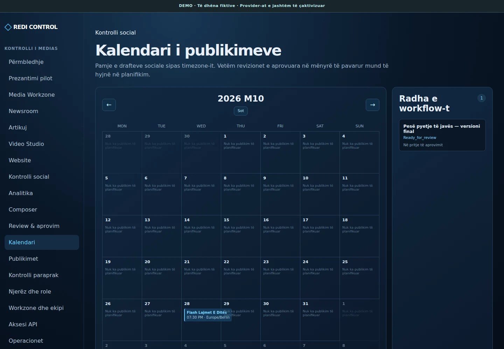

# REDI CONTROL

**From evidence to approved content.**

A multi-tenant control plane for editorial work, websites and social content. One story, independent channel variants and traceable human approvals.

[](https://github.com/IamRedi/redi-control-showcase/actions/workflows/ci.yml)

**Next.js · React · TypeScript · Fastify · PostgreSQL · RLS · Transactional outbox**



[Deutsch](README.md) · [Engineering](docs/ENGINEERING.md) · [Evidence](EVIDENCE.md) · [Scope](docs/PUBLIC_SCOPE.md)

## The engineering

PostgreSQL RLS and role-based authorization; revision-bound approvals; idempotency and transactional outbox; bounded connector and AI contracts.

- **Tenant boundaries:** authenticated actor and tenant context, application policy and PostgreSQL RLS; restricted runtime/auth roles.
- **Governed content:** research, evidence and a shared Content Item with independent website, Facebook and Instagram variants.
- **Controlled execution:** exact-revision approvals, payload hashes, preflight, idempotency, audit and outbox.
- **Modular architecture:** web, API, worker and storage boundaries over a shared typed domain; provider adapters stay behind interfaces.
- **AI boundaries:** tenant-scoped context, registered tools, schemas, budgets, provenance and human decision points.
- **SaaS/white-label:** Workzones, roles, installation configuration, entitlements and bounded customer APIs.

[A practical code tour](docs/ENGINEERING.md) · [Architecture](docs/ARCHITECTURE_SHOWCASE.md)

## A short application walkthrough

[](docs/assets/video/walkthrough-en.mp4)

**[Video DE](docs/assets/video/walkthrough-de.mp4)** · **[Video EN](docs/assets/video/walkthrough-en.mp4)** · [Transcript](docs/assets/video/transcript.md)

The screenshots show the actual application with a fictional newsroom. Aurora Media is synthetic fixture data. Meta, BusinessSite and HeyGen are disconnected. External news retrieval, AI calls and publishing are disabled in this showcase.

| Newsroom                                                  | Revision / review                                           | Calendar                                                  |
| --------------------------------------------------------- | ----------------------------------------------------------- | --------------------------------------------------------- |
|  |  |  |

## Evaluate locally

Node.js 22.22.1+ · npm · PostgreSQL 17 · Linux/macOS shell or WSL2

```bash
npm ci
npm run check
npm run test:integration
npm run showcase:offline-check
```

Integration tests require an explicitly configured disposable database; they recreate the `control` schema. The CI workflow provisions its own PostgreSQL 17 service. Never point tests or the demo at a persistent installation.

```bash
npm run demo:start
# Open http://127.0.0.1:8788/auth/local-demo
# The one-time token stays in ignored tmp/local-demo-token; it is never printed.
npm run demo:stop
```

The Docker demo uses its own Compose project, temporary database/object data and loopback ports. No live provider credential is needed. [Demo and reproducibility](docs/DEMO.md).

## Evidence and limits

Locally verified: **159 unit + 101 integration tests**, with 44 SQL migrations. All 50 original test files are retained; two new regression suites check the local login form and the serialized Social Studio contract. Exact local results, browser checks and CI status are reported in [EVIDENCE.md](EVIDENCE.md).

The visible workflow uses ordinary application sessions, tenant context and stored synthetic data. Seeded role/MFA state is a local fixture; it is not an external identity-provider acceptance. A disconnected provider remains disconnected. Read-only pilot history does not prove publishing, comments, webhooks or complete historical analytics.

The original private repository, pilot, production data, accounts and deployment remain separate. This fresh-history copy is an evaluation snapshot, not a production deployment.

## Author and license

**Redion Cekrezi / RediON** · [GitHub](https://github.com/IamRedi)

Source-available for local evaluation. This is not an open-source license; production/commercial use and redistribution require permission. [LICENSE](LICENSE) · [Dependencies and attribution](THIRD_PARTY.md).
