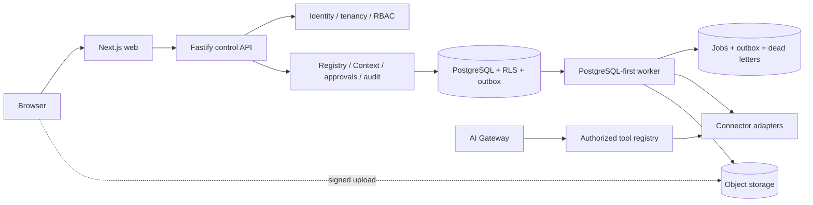

> Evaluation reference: private pilot names were replaced with fictional examples. Historical implementation/acceptance notes refer to the source project; they are not live-provider acceptance of Aurora Media or this copy. See [EVIDENCE](../EVIDENCE.md).

# Architecture

## Milestone 6 editorial boundary

Universal Media Profiles produce immutable revisions and separate Editorial Context Packs. Evidence Packs remain factual; Context Packs remain communication policy. Grounded editorial drafts link both artifacts, pass a second validation and require human approval before Unified Content promotion. Aurora Media exists only as an importable configuration preset.

## Chosen shape

Start as a TypeScript modular monolith in an npm-workspace monorepo: Next.js panel, Fastify control API, PostgreSQL, a separate worker process, future queue/storage adapters, and shared domain/identity/database/connector/UI packages. Logical modules share one deployment and database initially but communicate through explicit application interfaces and versioned events.

The AI Gateway and Automation Engine are in-process application modules initially, not independent network services. Worker concurrency is operational separation, not a microservice boundary.

## Production infrastructure boundary

The first production compute host is an Ubuntu mini PC using `deploy/production/`. This is an operator topology, not an application dependency. Web, API, worker and migrations are separate OCI containers; PostgreSQL is reached only through data-layer URLs; jobs/outbox remain PostgreSQL-backed and idempotent; media uses `ObjectStoragePort` with private S3-compatible storage and short-lived signed browser transfers. Caddy is the only published container and rejects unknown hosts.

Durable state is limited to PostgreSQL, private object storage and explicit Caddy/backup volumes. API/worker containers retain no required process-local state. This permits later movement to replicated app processes, multiple workers, dedicated/managed PostgreSQL, another S3-compatible provider and a separate load balancer without changing domain logic. The operational path is documented in Ubuntu mini PC production (private source reference omitted).

## Stack decision

- **Node.js 22.22.1 baseline and TypeScript 5.9:** one language across web/API/worker/SDK, strict typing, mature ecosystem. Node 24 LTS is a near-term upgrade candidate after CI/dependency verification.
- **Next.js App Router + React:** responsive shell, layouts, server rendering, accessibility ecosystem, self-hosting option. Trade-off: framework complexity and cache semantics require discipline; a Vite SPA would be simpler but would need separate routing/rendering conventions.
- **Fastify:** small explicit API boundary, schema-friendly plugins, and lower coupling than placing all control-plane endpoints inside Next.js. Trade-off: two local application processes.
- **PostgreSQL:** relational consistency, JSONB where justified, transactional outbox, and RLS defense in depth. Trade-off: RLS session context and migrations require careful integration tests.
- **PostgreSQL-first jobs plus transactional outbox:** safe state/event commits with no extra M1 service. Redis or another broker is introduced only after measured need and remains behind a queue adapter.
- **Portable object-storage interface:** local/test uses the filesystem-backed contract server; hardened deployments construct a vendor-neutral S3-compatible adapter with direct signed uploads, private objects and bucket readiness. True production multipart resume remains explicitly deferred and is not emulated in memory.
- **npm workspaces:** available with the supplied environment and sufficient at current scale. pnpm/Turborepo can be adopted only if install/build performance demonstrates need.
- **Vitest + future Playwright:** fast unit/contract tests and browser-level gates. Disposable PostgreSQL integration tests are required in Milestone 1.
- **Adapter-based OIDC identity:** Authorization Code + PKCE is the production contract; M1 uses only an injected test adapter. Opaque, hashed, rotating server-side sessions avoid placing identity/provider tokens in the browser session.
- **GitHub Actions:** CI calls the same npm and Docker-based gates as local development, keeping migration to another CI provider straightforward.

Versions are pinned by `package-lock.json`; upgrades are deliberate and must run all gates.

## Module boundaries

- Identity/Tenancy/RBAC owns actors, tenants, memberships, sessions, authorization decisions.
- Registry owns global platform/connector-version definitions and tenant-scoped installations, workspaces, connections, scopes, discovered capabilities, health, idempotency, rate windows, and feature/kill flags. Milestone 2 implements this boundary in PostgreSQL and the Connector SDK package without creating a service.
- Context Studio owns facts, sources, conflicts, confirmations, locks, published versions, and packs.
- Website owns proposals, previews, releases, and rollback references.
- Media owns tenant/workspace assets, variants, signed upload sessions, scans, metadata, usage, retention, and deletion workflows. Social owns OAuth account grants, immutable draft revisions, approvals, target attempts, and provider adapters.
- Installation owns white-label profiles, trusted canonical/custom domains, provider-scoped shared/dedicated OAuth references and server-side plan entitlements. Host resolution returns only an active installation boundary; it never accepts a tenant or installation override from request input.
- Approvals owns risk level, requested decision, reviewer, expiry, and immutable outcome.
- AI Gateway owns provider adapters, models, prompts, tool registry, budgets, usage, and eval references.
- Evidence Intelligence owns Research Case proposals, human decisions, immutable Evidence Packs, synthesis and independent grounding validation. It cannot call a provider directly.
- Automation owns definitions, versions, triggers, conditions, executions, and deduplication.
- Audit owns append-only security/business evidence and export policy.
- Source Ingestion owns provider-neutral discovery, hardened retrieval, feed parsing, conservative deduplication and usage accounting. It writes selected material into the existing Research Case source model; it never verifies evidence, synthesizes articles or publishes.

Modules may reference another module by stable application service or event, never its private tables.

All external research retrieval crosses `HardenedOutboundFetcher`. It permits HTTPS without URL credentials or custom ports, resolves and validates every DNS answer, pins the validated address for the request, revalidates each bounded redirect, rejects private/link-local/reserved networks, limits time/bytes/types and sends neither browser cookies nor session authorization. Remote HTML/XML/JSON is inert untrusted data; JavaScript is never executed.

## Request and event invariants

An authenticated request resolves actor, effective tenant, roles, correlation ID, and feature flags before a handler. The tenant comes from the trusted session/token and verified membership, not a body field. A database transaction runs as a non-owner role with `SET LOCAL app.tenant_id`. Application policy and RLS must both authorize the operation.

State changes and their outbox event commit together. Consumers are at-least-once, tenant-aware, idempotent, bounded by retry/backoff, and send terminal failures to a DLQ. Event schemas carry event ID/type/version, tenant, occurred-at, correlation, causation, and validated payload.

## External boundaries

Connectors own authentication, normalization, rate limiting, retry classification, webhook verification, and provider errors. Core modules never depend on provider payloads. Secrets are resolved at execution from a vault abstraction and never placed in events/logs. Official API facts must be rechecked before each connector milestone.

The Milestone 2 runtime loads a connection using trusted tenant context, then checks actor permission, lifecycle, version compatibility, module flag, kill switch, scopes, and discovered capability before validating a declared read command. JSON Schema validation covers input and output. Health adapters receive no user-controlled URL, and connector errors expose bounded codes only. The included Reference SaaS adapter is local, deterministic, and read-only; it is evidence for the SDK, not an external integration.

## Extraction criteria

Extract a module only with evidence such as independent scaling/SLO, isolation requirement, release cadence, or team ownership. Extraction requires a versioned contract, ownership, observability, failure model, data migration, and rollback plan.

See [domain model](DOMAIN_MODEL.md), [data model](DATA_MODEL.md), and [security](MULTI_TENANCY_AND_SECURITY.md).
