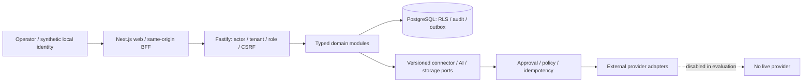

# Architecture and evaluation boundary

The system is a modular monolith. Web, API, worker and storage are operational
boundaries; domain packages retain the policy. Discovery or a visible channel
card grants no provider authority. A stored approval does not imply that a real
destination is connected.

The presentation uses a separate temporary database and fictional Aurora Media
Workzone. Runtime/auth database roles remain restricted. The local login token
is generated with entropy, stored as a hash, short-lived and single-use. The
session follows the ordinary application path. Seeded MFA/role state is explicitly
a synthetic local fixture. No external IdP, account or deployment is tested by it.

Provider credentials are absent, social/identity adapters are unconfigured,
source-ingestion/publication workers are not started, and outbound Node network
connections are denied. Production behavior is not changed to make the demo pass.
